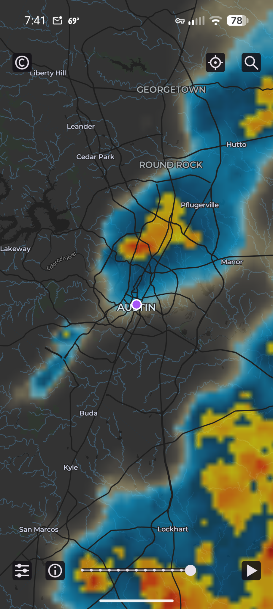
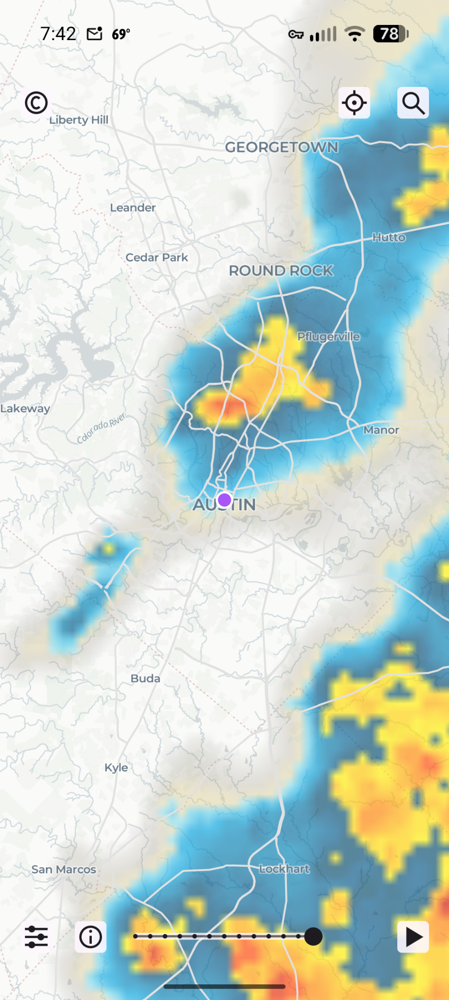
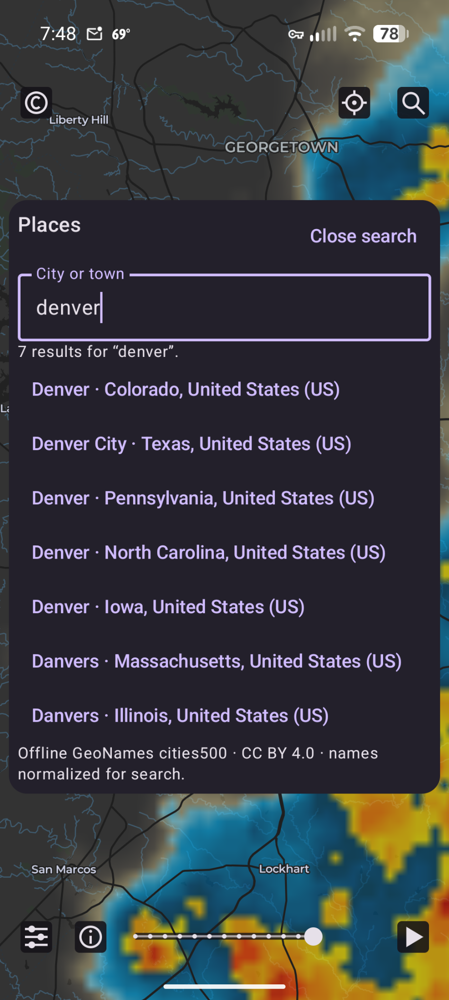
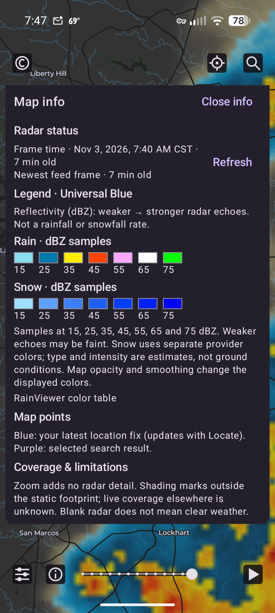
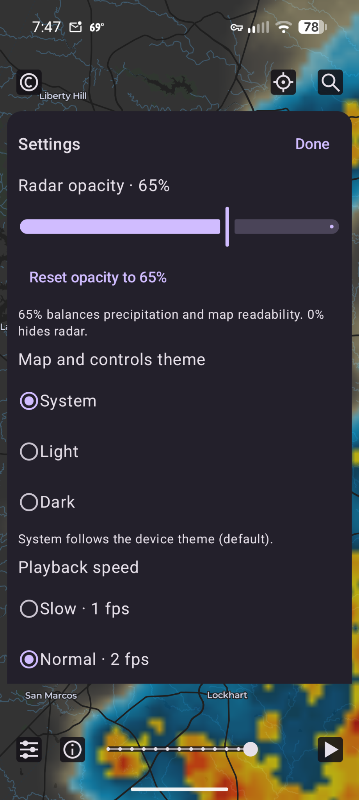
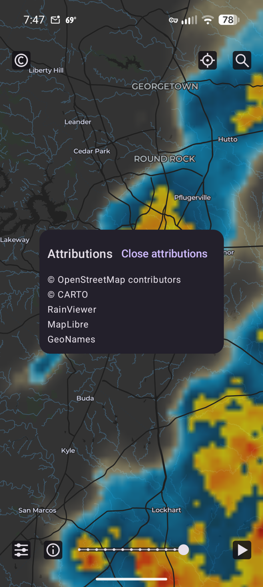

# Freedar

A lightweight Android precipitation radar viewer with an uncluttered, full-screen
map, animated radar, and offline city search. No accounts or Google Play Services
required.

## Download and install

**[Download Freedar v0.1.0](https://github.com/awstephan/freedar/releases/tag/v0.1.0)**
for **Android 8.0 or newer**. The release includes a signed universal APK
(`freedar-0.1.0.apk`, approximately 76 MB) and a `SHA256SUMS` checksum file.

1. Download the APK to your Android device.
2. Open it and allow installation from your browser or file manager when Android asks.
3. Launch Freedar. No account, API-key setup, or Play Store is needed.

**Coming from a debug build?** Uninstall it first because it uses a different
signing certificate. Uninstalling removes local settings and cached imagery.

**Updates:** install a newer signed APK from [Releases](https://github.com/awstephan/freedar/releases)
over the existing release to retain your settings. There is no automatic updater.

Release downloads follow repository visibility: while this repository is private,
GitHub requires repository access; once public, these same links work for everyone.

## Screenshots

| Dark radar | Light radar | Offline search |
| :---: | :---: | :---: |
| [](docs/screenshots/radar-dark.png) | [](docs/screenshots/radar-light.png) | [](docs/screenshots/search.png) |

Select a screenshot to view it at full resolution.

<details>
<summary>More screenshots</summary>

| Info and legend | Settings | Attributions |
| :---: | :---: | :---: |
| [](docs/screenshots/info.png) | [](docs/screenshots/settings.png) | [](docs/screenshots/attributions.png) |

</details>

## Features

- **Animated radar:** explore approximately two hours of precipitation history,
  scrub the timeline, or jump to the latest available frame.
- **Worldwide navigation:** pan and zoom freely, search cities and towns offline,
  or use optional one-shot location.
- **Your preferred view:** light, dark, and system themes; adjustable radar opacity
  and playback speed; portrait and landscape layouts.
- **Useful context:** radar freshness, a rain/snow legend, and coverage information.
- **Limited offline use:** reuse recently viewed imagery with bounded storage and
  an option to clear downloaded data.

Location permission is requested when you choose **Locate**. Later launches may
attempt a fresh fix if permission is already granted. There is no ongoing location
tracking or background radar polling.

See [Using Freedar](docs/using-freedar.md) for controls and map markers.

## Limitations

- Radar shows historical precipitation, not forecasts or weather alerts.
- Coverage and freshness depend on the providers. Blank radar does not mean clear weather.
- Initial history loading can be slow under provider request limits.
- Offline use reuses recently viewed imagery; it does not download complete maps.

## Build from source

Requires **JDK 17**, **Android SDK 35**, **build tools 35.0.0**, and platform-tools.
Set `JAVA_HOME` and `ANDROID_HOME`, accept the Android SDK licenses, and put your
own [CARTO client key](docs/providers.md#carto-provisioning-and-cost) in the ignored
`local.properties` file:

```properties
CARTO_API_KEY=your-project-key
```

```sh
./gradlew :app:assembleDebug
```

The APK is written to `app/build/outputs/apk/debug/app-debug.apk`.
Without a CARTO key, debug builds show a neutral background instead of a basemap.
Gradle does not automatically load `.env`.

See the [development guide](docs/development.md) for installation, environment
setup, tests, and signed release builds.

## Documentation

- [Using Freedar](docs/using-freedar.md) — controls, navigation, and map markers.
- [Development](docs/development.md) — build, test, signing, and validation records.
- [Product design](DESIGN.md) and [implementation behavior](docs/behavior.md).
- [Providers](docs/providers.md) — provisioning, quotas, terms, and the unresolved
  compact-attribution requirement.
- [Offline imagery](docs/downloaded-imagery.md), [place search](docs/place-search.md),
  and [appearance](docs/radar-appearance.md).

## License and credits

Freedar's source code is licensed under the [BSD 3-Clause License](LICENSE).

Built with [MapLibre](https://maplibre.org/), maps from
[OpenStreetMap contributors](https://www.openstreetmap.org/copyright) and
[CARTO](https://carto.com/attribution/), radar from
[RainViewer](https://www.rainviewer.com/), and place data from
[GeoNames](https://www.geonames.org/) (CC BY 4.0).

Third-party libraries, data, and services retain their own licenses and terms.
**Settings → About → Software licenses (offline)** contains the bundled license
texts and notices. See [third-party notices](docs/third-party-notices.md) for details.
