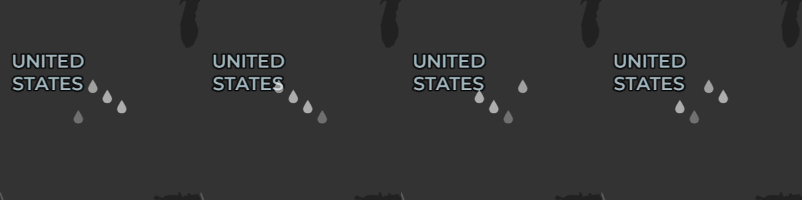
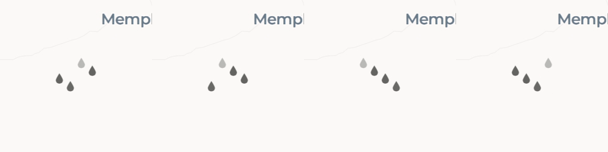

# Initial imagery loading feedback (#12)

Parent spec: [#11](https://github.com/awstephan/freedar/issues/11).

## Implementation

- One operation-owned indicator appears after 200 ms of continuous qualifying work
  and disappears immediately after its last contribution ends. A repeated/stale
  completion cannot release another operation.
- Basemap startup includes style loading and native source parsing/rendering, with
  tile failures and a 30-second readiness timeout. Its source-filtered observer is
  armed before style loading; radar can start as soon as the style is ready, and
  cannot hold the basemap contribution open. Native recovery clears initial errors.
- Radar exposes first-image preparation separately from its aggregate busy flag.
  Initial metadata and imagery count; cooldown, cancellation, terminal errors and
  refreshes with a displayed image do not. Existing Info feedback is retained.
- Four 5.5 dp teardrops occupy a centered 48 dp square, travel 24 dp over 900 ms,
  and use staggered phases with endpoint fades. White/dark and black/light are
  capped at 60% opacity. There are no input handlers, background or visible label.
- Panels suppress presentation without resetting elapsed loading time. Backgrounding
  removes the composable and stops its animation. Disabled system animations select
  stationary staggered drops; changes to the system setting are observed.
- The accessible description is “Loading map imagery”, without a live region.

### Owner-requested motion refinement

After viewing the device test, the owner requested randomized starting phases.
Each appearance now shuffles four independently jittered quarter-cycle phases,
retaining a minimum phase separation so the drops stay staggered. The phases
remain stable throughout that appearance; travel speed, horizontal spacing,
900 ms cycle and fades stay the same. Reduced motion retains stationary drops
at the original staggered heights. The motion crops below predate this refinement.
Both `InitialLoadingRenderingTest` device tests passed again on the Pixel after
this change, using the isolated validation package.

## Checks on 2026-11-03

Confirmed test seams with the owner: radar controller, shared indicator state, and
Android UI/native renderer. The new controller and delay tests were developed with
red/green checks. Focused JVM tests and production/instrumentation Kotlin compilation
pass.

Final automated run:

```sh
./gradlew test :app:lintDebug :app:assembleDebug :app:assembleDebugAndroidTest
```

Passed: 45 radar JVM tests and 19 app JVM tests (the app tests run for both debug
and release), debug lint, and both debug APK builds. Following a cleanup-method
rename, the connected-test attempt rebuilt production and instrumentation Kotlin
and APKs successfully, then failed because no device was connected.

## Review

### Standards

No documented-standard violations. One cleanup naming observation was addressed
by introducing explicit renderer `dispose()` rather than hiding basemap teardown
inside `stopCoverage()`.

### Spec

Review caught basemap readiness blocking radar startup and permanently retained
basemap failure feedback. Both were corrected: independent source-filtered loading,
and observer-owned errors cleared on recovery. Follow-up review found no further
concrete implementation violations. The initially outstanding device validation
was resumed on the connected physical device below.

Instrumentation fixtures cover delayed basemap tile readiness independently of
concurrent radar loading, centered accessible
startup feedback, touch passthrough, all four panels, foreground return, failure,
and static reduced-motion drops in both themes. All three focused instrumentation
tests now pass on the Pixel 9 Pro XL.

## Initial device validation limitation

Initially no connected Android device was available. The API-26 Google-free emulator could not
start with acceleration because `/dev/kvm` is absent; a software-only attempt
segfaulted before boot. The focused connected-test command failed with “device
offline”; the final full connected-test attempt failed with “No connected devices”.
This prevented device validation during the first implementation commit.

## Physical-device follow-up (2026-11-03)

Device: Pixel 9 Pro XL, Android 17 / API 37. The installed release uses a different
signing certificate. The first ordinary connected-test attempt failed with
`INSTALL_FAILED_UPDATE_INCOMPATIBLE`; Gradle's cleanup subsequently removed the
installed app. The signed release APK was restored, but its previous local
settings/downloads could not be recovered. The owner was informed. Subsequent
checks used a separate `com.freedar.validation` package, via a temporary Gradle
init script setting `android.buildTypes.debug.applicationIdSuffix = '.validation'`.
Use that isolation **before the first connected-test attempt** on a personal device.

The first device runs exposed three issues, fixed before validation:

- Espresso's old reflective `InputManager.getInstance()` call fails on API 37.
  Test-only Espresso 3.7.0 uses the public system service instead.
- The manual frame loop prevented Compose tests from becoming idle. The same
  900 ms linear drop cycle now uses Compose's supported infinite transition.
- The native fixture resolved its server URL on the main thread and attached the
  MapView before `onCreate`. URL construction now stays off-main and MapView
  initialization matches the production lifecycle.

Focused results:

- `InitialLoadingRenderingTest`: **2 passed**. Centering, 48 dp area, accessible
  description without live-region/click semantics, a real map tap through the
  indicator, Search/Settings/Info/Attributions suppression and immediate return,
  background/foreground return, and failure dismissal. With system animation scale
  zero, screenshots verify four separate stationary drops, correct theme contrast,
  and the 60% opacity cap. The system setting is restored afterward.
- `InitialBasemapRenderingTest`: **1 passed**. Real native loading remains pending
  while basemap tiles are delayed, radar requests start concurrently, and basemap
  readiness completes while radar is still blocked.

Full device-suite result: **24 passed, 2 failed, 4 skipped** (30 XML test cases).
The three new loading tests also passed within that full run. Failures were the
existing large-text corner-control pixel-height assertion and an offline-radar
assertion expecting the old text “Saved radar · original frame time, not live
data”. Live-provider checks and the opt-in search benchmark were skipped by their
existing opt-in guards. The full JVM suite and debug lint passed again after the
device fixes.

Baseline comparison used a detached worktree at **8749b7f**, before #12, with only
the test-package suffix and Espresso 3.7.0 supplied by an external init script.
The corner-control assertion failed at the identical line (36). The offline test
also failed on the baseline, but earlier, timing out during offline frame restoration (line
100); its expected old status text is independently absent from that baseline's
`MainActivity` (which already says “retained imagery is not live”). These are
recorded existing-suite issues, not a claim that the full device suite is green.

Reproduction commands (with the temporary validation-package init script):

```sh
./gradlew -I /tmp/opencode/freedar-validation.gradle :app:connectedDebugAndroidTest \
  -Pandroid.testInstrumentationRunnerArguments.class=com.freedar.InitialLoadingRenderingTest,com.freedar.InitialBasemapRenderingTest
./gradlew -I /tmp/opencode/freedar-validation.gradle :app:connectedDebugAndroidTest
./gradlew -I /tmp/opencode/freedar-validation.gradle test :app:lintDebug
```

Live visual check: recorded cold startup over CARTO Dark Matter and Positron on the
phone using the developer key. Four sequential center crops, approximately 225 ms
apart, show the falling phases and endpoint fades against real map labels/content:





The 48 dp area, 5.5 dp drops, 24 dp travel, 900 ms cycle and 60% maximum opacity were
retained: the drops are visible without obscuring the map. The evidence is cropped
from actual screen recordings, not a mockup. Raw recordings are local validation
artifacts; the cropped evidence omits system status and personal notifications.

Remaining limitations: no audible TalkBack session or API-26/older-hardware rerun
was performed in this follow-up. Accessibility semantics are instrumented; the
device evidence establishes API-37 behavior, not universal hardware coverage.

Frame-selection loading and current-view pan/zoom ownership are the subsequent
implementation tickets #13 and #14 under the same parent specification.
